# Đơn Hàng at tag `stage-4`

## What exists at this tag

`scripts/up.sh` still starts the lab: it runs `scripts/dev-secrets.sh`,
builds the Flutter web app with `--no-web-resources-cdn`, then
`docker compose up --build --wait`. Without a profile that starts the API, its
two services, their databases, RabbitMQ, Keycloak, Redis, Mailpit and the lab
box. Stage-4 adds little code: most of it is the decisions, reviews and plans
of an architect, written as the team's documents, and the release, incident,
multi-cluster and capacity labs that back them.

- **A modular monolith with two services split off**, as at `stage-3`:
  `DonHang.Api` holds Ordering (`DonHang.Domain`, `DonHang.Infrastructure`)
  and Catalog (`DonHang.Catalog`, reached only through `ICatalog`);
  `DonHang.Notifications` and `DonHang.Payments` each own a database.
  `OrderMessageContractTests` now keep the three copies of `OrderMessage`
  readable by each other, and `AppContractTests` keep the API's answers
  readable by the app (`contracts/app/`).
- **Domain model, messaging, refund saga, resilience, observability** as at
  `stage-3`. The old table `notifications` is gone from `donhang` (ADR 0008
  steps 1 and 2: `scripts/backend/drop-old-notifications.sh` dumps it into
  the volume `backups`, then the migration
  `20261101090000_DropOldNotificationsTable` drops it); the old table
  `payments` stays (debt N2).
- **Data**: as at `stage-3`, plus labs for a database the api cannot reach,
  migration locks on `donhang_perf`, promoting `db-replica` while `db` still
  runs (a split brain), load in steps, and SLIs read from the lab's
  Prometheus.
- **`DonHang.App`**: `lib/` is grouped by feature: `lib/features/auth/`,
  `lib/features/catalog/`, `lib/features/ordering/` (orders, the offline
  queue and its sync), each used by the others only through its public file
  (`auth.dart`, `catalog.dart`, `ordering.dart`), and `lib/shared/` (the HTTP
  client, local storage, the browser bridge); `lib/design/` is unchanged.
  `docs/design/app-structure.md` gives the rules;
  `test/architecture/feature_boundaries_test.dart` and
  `test/api_contract_test.dart` keep them. The web build no longer uses
  Google's CDN for the engine: app-web serves CanvasKit and the bundled
  Roboto, compressed; only fonts for characters the app does not bundle come
  from `fonts.gstatic.com`.
- **Staging (`donhang-staging`)**: Prometheus in the namespace `monitoring`
  (`platform/monitoring/` of the config repository, rules `slo.rules.yml`
  with their unit tests `slo.test.yml`) computes S1–S4 of
  `docs/design/slo.md` and fires burn-rate alerts; a NetworkPolicy lets it
  scrape the api. The release labs add the Deployments `api-green` and
  `api-canary` and move the HTTPRoute `api` between them by commits.
- **Kubernetes on `donhang`**: a team quota with a limit range in
  `tenancy-lessons`, mutual TLS with certificates from cert-manager and a
  Caddy sidecar in `mesh-lessons`, an HPA without metrics-server in
  `autoscale-lessons`. Two region clusters, `donhang-north` and
  `donhang-south`, exist only while the region labs run.
- **Golden path**: `templates/dotnet-service/` (Deployment, Service,
  NetworkPolicies, migration hook) and `scripts/devops/new-service.sh`.
- **Samples**: invoice signing with ECDsa and a certificate chain of the lab,
  a feature flag on for a stable share of customers.
- **Team docs**: ADRs 0011 to 0033 (`docs/adr/README.md` lists them all), SLOs,
  alerts, runbooks, a postmortem, the threat model, the capacity plan, design
  reviews of six system design problems, governance, strategy, roadmap,
  team structure, and the architect's own documents (a week, a quarterly
  health review, a skills checklist).

## Prerequisites

Docker Desktop, Flutter 3.47 and Bash (Git Bash on Windows) for the lab;
.NET SDK 10.0.300 (`global.json`) to run the tests, which also need Docker.
On Windows and macOS run `flutter test --exclude-tags golden`: the golden
images are made on Linux (ubuntu-24.04) and compared only there; refresh
them with the workflow `update-goldens.yml`. CI's `lab` job pins Flutter
3.47.2, because `web-bundle.sh` prints the sizes of one release's build.

The scripts marked `# Runs on the host` need, on the host:

- kind v0.33.0 and kubectl 1.34 (`scripts/k8s/`).
- OpenTofu 1.10 (`scripts/devops/tofu-*.sh`, `dr-drill.sh`).
- kubeseal 0.40 (`seal-secrets.sh`, `sealed-secrets-install.sh`,
  `rotate-db-password.sh`).
- Helm 3.19 (`helm-template.sh`, `helm-release.sh`, `traefik-install.sh`,
  `traefik-ha.sh`).
- `openssl` (Git Bash has it): `mutual-tls.sh` opens TLS connections with a
  client certificate through `openssl s_client`, because curl on Windows
  cannot use a PEM client key.
- Nothing for Syft, Grype, Cosign or promtool: `sbom.sh`, `scan-image.sh`,
  `verify-image.sh` and `alert-rules-test.sh` run them in containers pinned
  by digest. The GitHub CLI is not needed.

Network: `verify-image.sh` and `deploy-verified.sh` need `ghcr.io` and
Sigstore (`rekor.sigstore.dev`, `fulcio.sigstore.dev`); without them they
stop. Dependabot runs only on GitHub, not in the lab.

Every script reads `.env` and `secrets/`, so run `scripts/dev-secrets.sh`
(or `up.sh`) first. The region labs write `secrets/regions.kubeconfig`
(removed by `regions-down.sh`); `mutual-tls.sh` keeps its temporary client
key under `secrets/mutual-tls/` and deletes it at the end. Nothing under
`secrets/` or `backups/` is committed.

## Compose profiles and volumes

| Profile | Services | What for |
|---|---|---|
| none | lab, web, db, db-init, migrate, api, redis, mailpit, rabbitmq, notifications(-migrate), payments(-migrate), fake-gateway, keycloak, app-web | everything the app needs |
| `monitoring` | prometheus, grafana, loki, alloy, tempo | `scripts/devops/` metrics and logs, the tracing scripts of `scripts/backend/`, and `slo-report.sh` |
| `replica` | db-replica | a streaming replica (`replica-lag.sh`, `promote-replica.sh`) |
| `pitr` | db-pitr | a recovery to a point in time; `pitr.sh` creates and removes it |

No profile or volume is new at `stage-4`. `slo-report.sh` reads the lab's
Prometheus, so start the lab with `COMPOSE_PROFILES=monitoring` before it.
`db-unreachable.sh` and `slo-report.sh` stop `db` for a moment and start it
again (and restart Keycloak) before they end. `scripts/down.sh` removes every
volume.

## Clusters and their resources

All clusters are kind clusters on Docker Desktop; give Docker at least 12 GB
of memory to keep the lab, `donhang` and `donhang-staging` up together.

- `donhang` (one control plane, two workers, about 3.5 GB): the `stage-2`
  lessons and the stage-3 storage, networking, bare-metal and lifecycle
  lessons, which leave MetalLB, cert-manager 1.20.4, the namespaces
  `network-lessons`, `ha-lessons` and `operator-lessons` and the container
  `donhang-lb-client` behind. Stage-4 adds the namespaces `tenancy-lessons`
  (quota and limit range), `mesh-lessons` (mutual TLS, sidecars) and
  `autoscale-lessons` (HPA). No metrics-server runs anywhere: the HPA shows
  its target as `<unknown>`, which is what `autoscale.sh` is about.
  Docker Desktop does not route from the host to the `kind` network: a
  LoadBalancer address is reached from `donhang-lb-client`.
- `donhang-staging` (one node, about 4 GB with Argo CD, the Git server,
  Keycloak and the backend): created by `tofu-env.sh staging`, it publishes
  the Gateway on `127.0.0.1:18080` (HTTP) and `127.0.0.1:18443` (HTTPS) for
  `donhang.localhost` and `auth.donhang.localhost`. Trust
  `secrets/lab-ca.crt` to call it over HTTPS (with curl on Windows:
  `--cacert secrets/lab-ca.crt --ssl-no-revoke`). From stage-4 its Prometheus
  takes 100 to 150 MiB; while the release labs run, `api-green` and
  `api-canary` take about 340 MiB more. `tofu-teardown.sh --staging` removes
  it.
- `donhang-north` and `donhang-south` (one node each, about 0.9 to 1 GB
  each): `regions-up.sh` creates them, `applicationset.sh` registers them with
  staging's Argo CD, `failover.sh` puts a global entry in front of them,
  `regions-down.sh` deletes them.
- `donhang-iac`, `donhang-ha` and `donhang-lifecycle`, as at `stage-3`: the
  scripts that need them create and delete them.

With the lab, `donhang`, `donhang-staging` and both regions up, the kind
clusters alone take about 9.1 GiB. Before `applicationset.sh` and
`failover.sh`, stop Compose (`docker compose stop`) and the nodes of
`donhang` (`docker stop donhang-control-plane donhang-worker
donhang-worker2`); start them again afterwards with `docker compose start`
and `docker start`.

`dr-drill.sh` rebuilds staging with only the Application `apps/staging.yaml`;
Traefik, the edge, the policies and Prometheus come back with their own
scripts.

## Data flow

```mermaid
flowchart LR
  B[Browser: DonHang.App from app-web :8081] -->|HTTP :8080 / :8180| C[Caddy]
  C -->|/api/v1, /api/v2| API[DonHang.Api: Ordering + Catalog]
  C -->|/api/v1/refunds| PAY[DonHang.Payments]
  C -->|:8180| K[Keycloak]
  API -->|EF Core| P[(PostgreSQL)]
  API -->|cache-aside| R[(Redis)]
  API -->|outbox| MQ[RabbitMQ]
  MQ --> N[DonHang.Notifications]
  MQ --> PAY
  PAY -->|outbox| MQ
  PAY -->|refund| GW[fake-gateway]
  N -->|SMTP| MP[Mailpit :8025]
  N --> P
  PAY --> P
  API & N & PAY -->|OTLP| A[Alloy] --> T[Tempo]
```

The `Caddyfile` comment now says why the refunds block wins: `route` keeps
the blocks in the written order.

## Changed since `stage-3`

`stage-3` split the system where the lessons needed a split. `stage-4` keeps
that shape and writes down the decisions around it: why one deployment
serves every shop, how far each piece is released and observed, what the
team will not build yet, and how the architect checks a quarter later that
those decisions still hold. The code changes are small: the app grouped by
feature behind contracts, contract tests on both sides of the app and of
`OrderMessage`, the old `notifications` table dropped (debt N1 is paid),
staging's Prometheus with SLO alerts, release and multi-cluster labs, the
golden path's template, two samples. MailKit is 4.18.2 (it brings
`System.Security.Cryptography.Pkcs` 10.0.13, past two advisories of 10.0.0).

## Lessons at this tag

| Module | Lessons |
|---|---|
| backend/consistency-and-ownership | 8 |
| backend/security-architecture | 7 |
| backend/capacity-and-slo | 8 |
| design/choosing-architecture | 3 |
| design/evolutionary-and-tradeoffs | 4 |
| devops/platform-and-release-strategy | 8 |
| devops/incidents | 8 |
| frontend/stack-and-boundaries | 8 |
| frontend/performance-offline | 1 (web-bundle-size, moved to this tag) |
| k8s/multi-cluster-and-mesh | 7 |
| k8s/managed-vs-selfhosted | 7 |
| management/governance-and-strategy | 7 |
| management/teams-and-leadership | 8 |
| sysdesign/framework | 7 |
| sysdesign/multi-shop-and-notifications | 8 |
| sysdesign/payments-and-signing | 8 |
| sysdesign/search-and-analytics | 8 |
| sysdesign/chat-and-saas | 8 |
| sysdesign/architect-daily | 4 |

## Capturing outputs

`TAG=stage-4 scripts/capture-output.sh <script>` captures one script into
`outputs/stage-4/scripts/<module>/<name>.txt`, masked by
`outputs/unstable.regex`. Outputs of scripts that did not change since
`stage-3` start as copies of their `stage-3` outputs. The modes, each in the
order of the lessons:

- `--all`: every script except `scripts/k8s/`, the host scripts of
  `--devops-host` and `--release-host`, `verify-image.sh` and
  `change-hotspots.sh`, against the running lab started with
  `COMPOSE_PROFILES=monitoring`. From stage-4 it includes the eight new
  scripts of `scripts/backend/` (`db-unreachable`, `drop-old-notifications`,
  `load-steps`, `message-shapes`, `migration-locks`, `promote-replica`,
  `shared-credentials`, `slo-report`), the three new or changed ones of
  `scripts/frontend/` (`package-reach`, `web-bundle`,
  `what-the-server-sends`) and four of `scripts/devops/` that need no
  cluster: `alert-rules-test`, `new-service`, `delivery-metrics` and
  `service-footprint`. CI's `lab` job.
- `--k8s`: deletes `donhang`, runs the `stage-2` k8s scripts on a new one.
  CI's `k8s` job.
- `--devops-host`: the OpenTofu, GitOps, sealed secrets and disaster
  recovery scripts, ending with `deploy-verified.sh` (needs `ghcr.io` and
  Sigstore); recreates `donhang-staging`.
- `--k8s-host`: the stage-3 k8s scripts on `donhang-staging` and `donhang`,
  then the stage-4 ones: `team-quota`, `regions-up`, `applicationset`,
  `failover`, `regions-down`, `mutual-tls`, `sidecar-proxy`, `autoscale`,
  `node-capacity`.
- `--release-host` (from stage-4, after the two above, on the same
  `donhang-staging`; about 16 minutes): `blue-green`, `canary`,
  `canary-steps`, `canary-steps --bad` and `incident-drill`, which waits for
  its alert to fire and then to resolve. It starts staging's Prometheus on
  the way.

The last three, `verify-image.sh` and `change-hotspots.sh` run only on a
learner's machine; CI does not check their outputs.

## What a lesson can learn from each new place

Every file added or changed since `stage-3`, by topic. The module column
names the lessons that use a file at this tag.

| Path | Module | What a lesson learns from it |
|---|---|---|
| `DonHang.App/lib/features/auth/auth.dart`, `auth_callback_screen.dart`, `auth_controller.dart`, `browser.dart`, `browser_stub.dart`, `browser_web.dart`, `keycloak_sign_in.dart`, `login_screen.dart`, `token_subject.dart` | frontend/stack-and-boundaries | a feature folder behind one public file: signing in |
| `DonHang.App/lib/features/catalog/catalog.dart`, `catalog_api.dart`, `catalog_providers.dart`, `product.dart`, `product_catalog.dart`, `product_detail_screen.dart`, `product_list_screen.dart`, `product_tile.dart` | frontend/stack-and-boundaries | the catalog feature, its own API client and providers |
| `DonHang.App/lib/features/ordering/ordering.dart`, `orders_api.dart`, `order.dart`, `create_order_screen.dart`, `order_detail_screen.dart`, `order_queue.dart`, `queue_sync.dart`, `queued_orders_screen.dart` | frontend/stack-and-boundaries, sysdesign/chat-and-saas | the ordering feature with the offline queue (moved from `lib/offline/`); where a chat screen would plug in |
| `DonHang.App/lib/shared/api_client.dart`, `browser.dart`, `browser_stub.dart`, `browser_web.dart`, `local_store.dart` | frontend/stack-and-boundaries | what every feature may use: the HTTP client, local storage, the browser bridge |
| `DonHang.App/lib/main.dart`, `lib/router.dart`, `pubspec.yaml`, `pubspec.lock` | frontend/stack-and-boundaries | the app wired from features; its dependencies |
| `DonHang.App/test/architecture/feature_boundaries_test.dart` | frontend/stack-and-boundaries, design/evolutionary-and-tradeoffs | a fitness function: features meet only through public files |
| `DonHang.App/test/api_contract_test.dart`, `contracts/app/order.json`, `contracts/app/product.json`, `DonHang.Tests/Integration/AppContractTests.cs` | frontend/stack-and-boundaries | a contract tested from both sides: the app reads the samples, the API still returns them |
| `DonHang.App/test/api_client_test.dart`, `create_order_screen_test.dart`, `offline_products_test.dart`, `product_catalog_test.dart`, `product_list_rebuild_test.dart`, `product_list_screen_test.dart`, `queue_sync_test.dart`, `widget_test.dart` | (none at this tag) | the stage-3 tests, pointed at the new paths |
| `docs/design/app-structure.md`, `docs/design/app-experience.md`, `docs/adr/0017-giu-mot-ma-flutter-cho-moi-nen-tang.md`, `docs/adr/0018-app-goi-thang-api-chua-them-bff.md` | frontend/stack-and-boundaries | the app's structure rules, its experience measures, one Flutter code base, no BFF yet |
| `scripts/frontend/package-reach.sh`, `what-the-server-sends.sh`, `web-bundle.sh`, `scripts/up.sh` | frontend/stack-and-boundaries, frontend/performance-offline | how far each dependency reaches; what a reader without JavaScript gets; what the browser downloads with the engine served by app-web |
| `DonHang.Tests/Messaging/OrderMessageContractTests.cs` | backend/consistency-and-ownership | a message contract kept by a test on every pull request |
| `DonHang.Infrastructure/Migrations/20261101090000_DropOldNotificationsTable.cs`, `20261101090000_DropOldNotificationsTable.Designer.cs`, `DonHang.Tests/Integration/PostgresFixture.cs`, `scripts/backend/drop-old-notifications.sh` | backend/consistency-and-ownership | contracting a schema: dump first, then drop the table no service owns (debt N1 paid) |
| `scripts/backend/db-unreachable.sh`, `migration-locks.sh`, `message-shapes.sh` | backend/consistency-and-ownership | consistency against availability, migration locks, a message shape that changes under a consumer |
| `docs/design/consistency-per-operation.md`, `data-ownership.md`, `multi-shop-data-rollout.md`, `docs/adr/0013-du-lieu-cua-hang-trong-bang-chung.md` | backend/consistency-and-ownership | consistency chosen per operation, one owner per piece of data, shop data in shared tables |
| `scripts/backend/shared-credentials.sh`, `docs/design/threat-model.md`, `audit-log.md`, `docs/adr/0014-keycloak-giu-email-khach-hang.md`, `0015-khoa-ky-hoa-don-trong-hsm.md`, `deploy/gitops/config-repo-kustomize/base/network-policies.yaml`, `base/egress-policies.yaml`, `Caddyfile` | backend/security-architecture | a threat model, trust boundaries, shared credentials, an audit log, where a signing key lives |
| `samples/DonHang.Samples/Samples/Security/InvoiceSigning.cs`, `InvoiceCertificates.cs`, `samples/DonHang.Samples.Tests/InvoiceSigningTests.cs` | backend/security-architecture, sysdesign/payments-and-signing | signing an invoice and checking it with a certificate chain |
| `scripts/backend/slo-report.sh`, `load-steps.sh`, `docs/design/slo.md`, `capacity-plan.md`, `backend-review-checklist.md`, `docs/adr/0016-gioi-han-tai-theo-cua-hang.md` | backend/capacity-and-slo | SLIs, SLOs and error budget, load in steps, a capacity plan, a review checklist, per-shop limits |
| `docs/adr/0011-khong-boc-message-broker-sau-lop-chung.md`, `0012-phuc-vu-moi-cua-hang-tu-mot-ban-trien-khai.md`, `docs/team/multi-shop-requirements.md` | design/choosing-architecture | architectural drivers, a rejected abstraction, one deployment for every shop |
| `docs/design/fitness-functions.md`, `multi-shop-architecture-review.md`, `docs/team/tech-debt-register.md`, `.github/workflows/ci.yml` | design/evolutionary-and-tradeoffs | fitness functions and the jobs that run them, a reduced ATAM review, debt in hours of interest and principal |
| `deploy/gitops/lessons/api-green.yaml`, `api-canary.yaml`, `scripts/devops/blue-green.sh`, `canary.sh`, `canary-steps.sh`, `scripts/lib/release.sh`, `docs/design/canary-checks.md`, `feature-flags.md`, `docs/adr/0019-chien-luoc-phat-hanh-theo-thanh-phan.md` | devops/platform-and-release-strategy | blue-green, a canary by weights, progressive delivery with a stop rule, a release strategy per component |
| `samples/DonHang.Samples/Samples/Release/FeatureFlags.cs`, `samples/DonHang.Samples.Tests/FeatureFlagsTests.cs` | devops/platform-and-release-strategy | a feature flag on for a stable share of customers |
| `templates/dotnet-service/deployment.yaml`, `kustomization.yaml`, `migrate-hook.yaml`, `network-policies.yaml`, `service.yaml`, `scripts/devops/new-service.sh`, `service-footprint.sh`, `docs/team/golden-path.md`, `platform-capabilities.md` | devops/platform-and-release-strategy | a golden path and the platform's capabilities; how much a new service touches outside its code |
| `scripts/devops/delivery-metrics.sh`, `docs/team/delivery-metrics.md` | devops/platform-and-release-strategy, devops/incidents | the four delivery metrics from Git history |
| `deploy/gitops/config-repo/apps/monitoring-staging.yaml`, `platform/monitoring/kustomization.yaml`, `platform/monitoring/prometheus.yaml`, `platform/monitoring/rules/slo.rules.yml`, `platform/monitoring/rules/slo.test.yml`, `scripts/devops/alert-rules-test.sh` | devops/incidents | recording rules for SLIs, multi-window burn-rate alerts, their unit tests |
| `scripts/devops/incident-drill.sh`, `docs/design/alerts.md`, `docs/runbooks/order-placement-burn.md`, `order-placement-latency-burn.md`, `product-reads-burn.md`, `refund-requests-burn.md`, `docs/postmortems/0001-doc-san-pham-tra-503.md`, `docs/postmortems/template.md`, `docs/team/on-call.md`, `incident-response.md` | devops/incidents | an alert, its runbook, incident roles, a blameless postmortem |
| `deploy/k8s/lessons/team-quota.yaml`, `team-limit-range.yaml`, `scripts/k8s/team-quota.sh` | k8s/multi-cluster-and-mesh | sharing a cluster between teams: quota and limit range |
| `scripts/k8s/regions-up.sh`, `regions-down.sh`, `applicationset.sh`, `failover.sh`, `scripts/lib/regions.sh`, `deploy/gitops/lessons/regions-appset.yaml`, `deploy/gitops/config-repo/platform/regions/echo-region.yaml`, `deploy/k8s/regions/global-entry.Caddyfile`, `scripts/backend/promote-replica.sh`, `docs/adr/0020-mot-region-phuc-hoi-tu-ban-sao-luu.md` | k8s/multi-cluster-and-mesh | one Argo CD for many clusters, failover between regions, a promoted replica that disagrees with its primary (split brain), one region restored from backups |
| `deploy/k8s/lessons/mtls-certificates.yaml`, `echo-mtls.yaml`, `echo-mtls-sidecar.yaml`, `mtls-client-sidecar.yaml`, `scripts/k8s/mutual-tls.sh`, `sidecar-proxy.sh`, `scripts/lib/network-lessons.sh`, `docs/adr/0021-chua-dung-service-mesh.md` | k8s/multi-cluster-and-mesh | mutual TLS, a sidecar proxy, when a mesh pays off |
| `deploy/k8s/lessons/cpu-echo.yaml`, `cpu-echo-hpa.yaml`, `scripts/k8s/autoscale.sh`, `node-capacity.sh` | k8s/managed-vs-selfhosted | an HPA without metrics, requests against node capacity |
| `docs/design/cluster-cost.md`, `cluster-migration-plan.md`, `cluster-review-checklist.md`, `docs/adr/0022-production-tren-kubernetes-managed.md`, `0023-khoa-ky-hoa-don-trong-hsm-cua-nha-cung-cap.md` | k8s/managed-vs-selfhosted | managed against self-hosted, what a cluster costs, a migration plan, a cluster review checklist |
| `scripts/k8s/deploy-api.sh`, `health.sh`, `readiness.sh`, `service-dns.sh`, `service.sh`, `smoke-test.sh` | (stage-2 lessons) | unchanged output: their short-lived Pods wait for kubectl to attach before they print |
| `docs/team/architecture-governance.md`, `technical-strategy.md`, `roadmap.md`, `release-calendar.md`, `compliance-controls.md`, `email-service-evaluation.md`, `docs/adr/0024-dich-vu-gui-email-ben-ngoai.md`, `docs/adr/README.md` | management/governance-and-strategy | lightweight governance, a weighted scoring matrix, a technical strategy, a roadmap, compliance controls |
| `docs/team/team-structure.md`, `on-call-staffing.md`, `blameless-culture.md`, `mentoring-plan.md`, `leadership-brief-platform-team.md`, `docs/adr/0025-to-chuc-doi-theo-luong-va-doi-platform.md` | management/teams-and-leadership | team types and their interactions, sustainable on-call, mentoring, presenting to leadership |
| `docs/design/system-design-method.md`, `design-review-template.md` | sysdesign/framework | the steps of system design and the document a review reads |
| `docs/team/multi-shop-open-requirements.md`, `notification-requirements.md`, `docs/design/multi-shop-design-review.md`, `notification-design-review.md`, `docs/adr/0026-cua-hang-lon-chuyen-sang-database-rieng.md`, `0027-thong-bao-nhieu-kenh-email-la-kenh-chinh.md` | sysdesign/multi-shop-and-notifications | designing for many shops and for notifications on several channels |
| `docs/team/reconciliation-requirements.md`, `bank-signing-requirements.md`, `docs/design/reconciliation-design-review.md`, `bank-signing-design-review.md`, `docs/adr/0028-doi-soat-hoan-tien-hang-ngay-voi-bao-cao-cua-cong.md`, `0029-ky-bang-ke-ngan-hang-kem-dau-thoi-gian.md` | sysdesign/payments-and-signing | reconciliation with a gateway's report, a signed statement a bank checks years later |
| `docs/team/product-search-requirements.md`, `reporting-requirements.md`, `docs/design/product-search-design-review.md`, `reporting-design-review.md`, `docs/adr/0030-tim-san-pham-bang-full-text-search-cua-postgresql.md`, `0031-bao-cao-tu-database-bao-cao-rieng.md` | sysdesign/search-and-analytics | search inside the database, reports from a database of their own |
| `docs/team/support-chat-requirements.md`, `saas-platform-requirements.md`, `docs/design/support-chat-design-review.md`, `saas-platform-design-review.md`, `cost-per-shop.md`, `docs/adr/0032-chat-ho-tro-qua-websocket-trong-service-rieng.md`, `0033-cua-hang-tu-dang-ky-goi-la-du-lieu.md` | sysdesign/chat-and-saas | a chat over long-lived connections, self-service shops, cost per shop |
| `docs/team/architect-week.md`, `docs/design/architecture-health-review.md`, `docs/team/architecture-skills-checklist.md` | sysdesign/architect-daily | an architect's week, a quarterly check that decisions still hold, what to practise next |
| `scripts/capture-output.sh`, `.github/workflows/ci.yml`, `release.yml`, `update-goldens.yml`, `Directory.Packages.props`, `**/packages.lock.json`, `scripts/backend/auth-and-orders.sh`, `trace-refund.sh`, `scripts/lib/tempo.sh` | (plumbing) | capture modes, pinned actions and packages, a trace counted complete only when it stops growing |
| `STAGE.md`, `README.md`, `outputs/stage-4/` | sysdesign/architect-daily | this table: a file leads back to the topic it was used for |

The authoritative list of files this tag must contain is
`tools/validate --manifest 4` in the curriculum repository.
