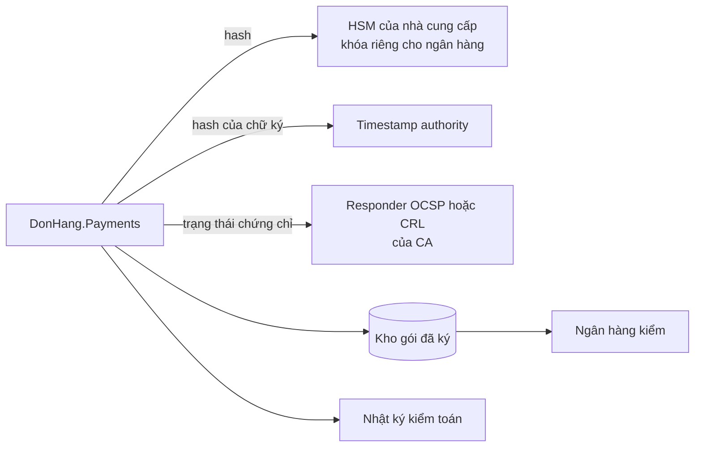

# Review thiết kế: bảng kê ký số cho ngân hàng

Theo `design-review-template.md`. Gửi trước buổi review; câu hỏi trong buổi
review ghi ở mục cuối. Mọi con số ghi "giả định" là giả định của dự án; tài
liệu không nêu tên CA, timestamp authority hay sản phẩm HSM nào.

Trạng thái: đã review
Người đề xuất: lập trình viên backend, cùng trưởng nhóm

### Quyết định cần review

Payments ký bảng kê hằng tháng trong HSM của nhà cung cấp bằng một khóa riêng
cho ngân hàng, kèm dấu thời gian và trạng thái thu hồi lấy lúc ký. Đề xuất ghi
ở ADR 0029.

### Bối cảnh và driver (bước 1)

Yêu cầu ở `docs/team/bank-signing-requirements.md`; không mở lại ADR 0015,
0022, 0023. Driver xếp hạng:

1. Kiểm được trong nhiều năm, kể cả sau khi chứng chỉ hết hạn.
2. Thiệt hại của một khóa lộ bị giới hạn theo thời gian.
3. Không khóa nào nằm ngoài HSM.

### Ước lượng và giả định (bước 2)

- Nhiều nhất vài trăm bảng kê mỗi tháng (giả định): tải ký không đáng kể.
- Một bảng kê được chờ ký vài giờ (giả định), trước hạn của ngân hàng là ngày
  làm việc thứ năm của tháng sau (giả định).
- Kiểm được trong 10 năm (giả định).

### Sơ đồ tổng thể (bước 3)

Đường đi: Payments dựng bảng kê, xin chữ ký từ HSM, xin dấu thời gian cho chữ
ký, lấy trạng thái thu hồi, lưu gói, ghi mỗi bước vào nhật ký kiểm toán, rồi
gửi gói cho ngân hàng.

### Đi sâu: kiểm sau 10 năm (bước 4)

Ngân hàng kiểm một gói chỉ với gói đó, theo thứ tự:

1. Chữ ký đúng với public key trong chứng chỉ, trên đúng các byte của bảng kê.
2. Chuỗi chứng chỉ đi lên tới một root ngân hàng tin.
3. Dấu thời gian đúng, của một timestamp authority ngân hàng tin: lấy thời
   điểm ký từ đó.
4. Trạng thái thu hồi đã lưu cho thấy chứng chỉ còn hiệu lực ở thời điểm đó.

Giờ của server không dùng được: ai giữ khóa lộ cũng ký được với bất kỳ giờ nào
server cho thấy. `InvoiceCertificates.cs` chỉ là sample cho lab: nó tin một root
riêng của Đơn Hàng mà ngân hàng không tin, và đặt
`RevocationMode.NoCheck`, không kiểm thu hồi.

### Nút cổ chai và điểm hỏng đơn lẻ (bước 5)

- Không nút cổ chai về tải.
- HSM, timestamp authority và dịch vụ trạng thái của CA, mỗi cái là điểm hỏng
  đơn lẻ cho việc ký, không cho việc nhận đơn hay hoàn tiền: bảng kê chờ vài
  giờ và được thử lại.

### Phương án bị loại và điểm đánh đổi (bước 3 và 4)

- Giờ server và root riêng: trái driver 1 và 2.
- HSM riêng của Đơn Hàng: lý do của ADR 0023; hợp đồng đòi máy riêng là điều
  kiện mở lại của ADR 0022.
- Dùng chung khóa hóa đơn: một lần thu hồi chạm hóa đơn của cửa hàng khác.
- Điểm đánh đổi, OCSP so với CRL: OCSP cho câu trả lời mới về một chứng chỉ
  nhưng cần responder chạy ở mỗi lần hỏi; CRL lấy trước và giữ được, nhưng có
  thể cũ tới một kỳ phát hành.
- Điểm đánh đổi, lưu trạng thái lúc ký: gói lớn hơn, nhưng kiểm sau nhiều năm
  không cần dịch vụ của CA còn chạy.
- Điểm đánh đổi, khóa riêng cho ngân hàng: thu hồi không chạm hóa đơn, thêm một
  khóa và một chứng chỉ phải gia hạn.
- Điểm đánh đổi, đóng dấu lại: chứng chỉ của timestamp authority cũng hết hạn,
  nên gói được đóng dấu thời gian lại trước đó; một job lặp lại là chi phí.

### Rủi ro và câu hỏi mở

| Rủi ro hoặc câu hỏi | Ai trả lời (vai trò) | Hạn hoặc bước tiếp theo |
|---|---|---|
| Timestamp authority lỗi cuối tháng, sát hạn của ngân hàng | Lập trình viên backend | Ký từ ngày đầu tháng, thử lại nhiều giờ; báo ngân hàng nếu sắp trễ hạn |
| Ngân hàng chưa xác nhận root và CA nào | Product owner | Trước khi xin chứng chỉ |
| Ai giữ quyền quản trị khóa của ngân hàng, tách khỏi quyền ký | Trưởng nhóm | Theo ADR 0023; rà soát theo TT-7 |

### ADR sẽ viết

ADR 0029 (đã có). Hợp đồng đòi máy riêng: một ADR mới thay ADR 0023 cho đúng
khóa này.

### Câu hỏi phản biện trong buổi review

| Câu hỏi | Trả lời, trỏ driver, ADR hoặc rủi ro | Việc tiếp theo | Người phụ trách (vai trò) |
|---|---|---|---|
| Sao không ký bằng giờ server và root của Đơn Hàng? | Driver 1, 2: ngân hàng chỉ tin root họ chỉ định; khóa lộ ghi được bất kỳ giờ nào server cho thấy | Không | |
| Khóa lộ thì bảng kê cũ thì sao? | Thu hồi: bảng kê có dấu thời gian trước lúc thu hồi vẫn hợp lệ, sau thì không; nhật ký kiểm toán cho thấy Payments thật sự đã xin ký những bảng kê nào | Không | |
| Sao ngân hàng không có HSM riêng của Đơn Hàng? | Lý do của ADR 0023; hợp đồng đòi máy riêng là điều kiện mở lại của ADR 0022, khi đó ADR mới thay 0023 cho đúng khóa này | Không | |
| Timestamp authority sập cuối tháng thì sao? | Bảng kê chờ và được ký muộn, trong hạn của ngân hàng | Ghi rủi ro | Lập trình viên backend |
| Ngân hàng thứ hai thì sao? | Điều kiện xem lại của ADR 0029: mỗi ngân hàng một khóa? | Mở | Trưởng nhóm |
