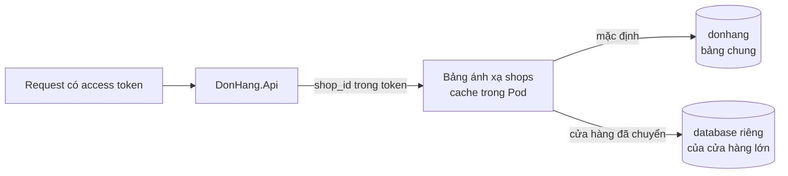

# Review thiết kế: cửa hàng lớn và khôi phục riêng một cửa hàng

Theo `design-review-template.md`. Gửi trước buổi review; câu hỏi trong buổi
review ghi ở mục cuối. Mọi con số ghi "giả định" là giả định của dự án. Khác
`multi-shop-architecture-review.md`: tài liệu đó đánh giá kiến trúc đa cửa
hàng đã chọn; tài liệu này review một thiết kế cho phần còn để mở.

Trạng thái: đã review
Người đề xuất: lập trình viên backend, cùng trưởng nhóm

### Quyết định cần review

Cửa hàng lớn chuyển sang database riêng qua bảng ánh xạ cửa hàng; mọi cửa hàng
khác giữ bảng chung. Đề xuất ghi ở ADR 0026.

### Bối cảnh và driver (bước 1)

Yêu cầu ở `docs/team/multi-shop-open-requirements.md`; không mở lại ADR 0012,
0013, 0016 và `multi-shop-data-rollout.md`. Driver xếp hạng:

1. Các cửa hàng khác không thấy thay đổi khi một cửa hàng chuyển (CH-5).
2. Khôi phục được riêng một cửa hàng (CH-6).
3. Tải của một cửa hàng lớn rời được khỏi bảng chung.

### Ước lượng và giả định (bước 2)

- 10 cửa hàng lớn giữ khoảng 30% số đơn; cửa hàng lớn nhất khoảng 10% (giả
  định, product owner xác nhận từ hợp đồng).
- Dữ liệu mỗi cửa hàng trong `donhang_notifications`, `donhang_payments` nhỏ so
  với trong `donhang`: chỉ `donhang` cần chuyển cửa hàng ra.
- Số database riêng dự kiến: vài cái, không quá khoảng 10 (giả định).
- Khôi phục riêng: vài lần mỗi năm (giả định, đội vận hành xác nhận).

### Sơ đồ tổng thể (bước 3)

Đường đi: request lấy cửa hàng từ access token (release 2), tra bảng ánh xạ
(chủ là Ordering), mở kết nối tới database ghi ở đó. Bảng ánh xạ không đọc được
thì request không biết database nào: bảng là phụ thuộc của mọi request, nên mỗi
Pod giữ nó trong bộ nhớ 30 giây (giả định). Notifications và Payments không
tra bảng này.

### Đi sâu: chuyển một cửa hàng (bước 4)

1. Dừng ghi của cửa hàng đó: API trả lỗi tạm thời cho lệnh ghi của nó; đọc vẫn
   chạy từ bảng chung.
2. Chờ relay gửi hết các dòng outbox của cửa hàng đó, để không message nào
   còn nằm lại ở chỗ cũ.
3. Chép các dòng của cửa hàng sang database riêng, rồi đếm dòng từng bảng ở hai
   bên; lệch thì dừng, mở lại ghi ở chỗ cũ.
4. Đổi dòng của cửa hàng trong bảng ánh xạ sang database riêng.
5. Mở lại ghi, sau khi đã qua hết thời gian cache bảng ánh xạ của mọi Pod.

Thời gian dừng ghi dài hơn thời gian cache bảng ánh xạ, nên sau khi đổi không
Pod nào còn ghi vào chỗ cũ. Các cửa hàng khác không dừng ở bước nào. Dòng cũ
trong bảng chung chỉ bị xóa sau một khoảng kiểm tra (giả định một tuần).

### Đi sâu: khôi phục một cửa hàng (bước 4)

- Cửa hàng ở bảng chung: khôi phục cả server về ngay trước sự cố vào một
  instance riêng, như `scripts/devops/pitr.sh` làm với container `db-pitr`;
  đọc các dòng của cửa hàng đó từ instance riêng và chép lại vào `donhang`.
  Các cửa hàng khác không quay về quá khứ, nhưng việc chép là việc tay, chậm.
- Cửa hàng có database riêng: khôi phục database đó một mình; không cửa hàng
  nào khác bị chạm.

### Nút cổ chai và điểm hỏng đơn lẻ (bước 5)

Mỗi database API chạm tới có pool kết nối riêng trong mỗi Pod. Quy tắc của
`capacity-plan.md` thành: số Pod × kết nối tối đa mỗi Pod × số database trên
một server, cộng kết nối của các service khác, nhỏ hơn `max_connections` (đọc
bằng `SHOW max_connections`). Đây là giới hạn chạm trước khi số database riêng
tăng; bước kế tiếp là đặt database riêng lên server khác.

Điểm hỏng đơn lẻ mới: bảng ánh xạ. Cache trong Pod cho mọi request chạy tiếp
30 giây khi không đọc được nó; quá thời gian đó, request mới dừng.

### Phương án bị loại và điểm đánh đổi (bước 3 và 4)

- Database cho mỗi cửa hàng: bị loại theo ADR 0013, mỗi migration chạy một lần
  cho mỗi cửa hàng, 1.000 lần.
- Bản triển khai riêng cho cửa hàng lớn: ADR 0012 giữ cho hợp đồng đòi nó.
- Điểm đánh đổi: chuyển một cửa hàng lớn được cô lập tải và khôi phục của nó,
  nhưng mỗi database thêm làm migration, sao lưu và kết nối tăng theo. Driver
  quyết định: 3 (tải rời khỏi bảng chung) và 2; vì vậy chỉ chuyển khi chạm điều
  kiện của ADR 0026.
- Điểm đánh đổi: khôi phục cửa hàng ở bảng chung chậm và làm tay hơn khôi phục
  một database riêng. Chấp nhận, vì khôi phục riêng giả định là hiếm.

### Rủi ro và câu hỏi mở

| Rủi ro hoặc câu hỏi | Ai trả lời (vai trò) | Hạn hoặc bước tiếp theo |
|---|---|---|
| Một lần phát hành để một database riêng đi sau migration | Lập trình viên backend | Migration theo expand và contract; job kiểm phiên bản schema từng database |
| Báo cáo gộp mọi cửa hàng đọc thế nào khi một cửa hàng có database riêng? Một truy vấn không join được hai database | Product owner, cùng lập trình viên backend | Mở; trả lời khi thiết kế báo cáo |
| Đếm dòng khớp nhưng nội dung lệch | Tester | Thêm so sánh tổng kiểm trên vài cột trước khi đổi bảng ánh xạ |

### ADR sẽ viết

ADR 0026 (đã có). Thiết kế báo cáo gộp nhiều cửa hàng cần ADR riêng khi làm.

### Câu hỏi phản biện trong buổi review

| Câu hỏi | Trả lời, trỏ driver, ADR hoặc rủi ro | Việc tiếp theo | Người phụ trách (vai trò) |
|---|---|---|---|
| Sao không cho mỗi cửa hàng một database luôn? | ADR 0013: mỗi migration chạy 1.000 lần | Không | |
| Trong lúc cửa hàng lớn chờ chuyển, gì bảo vệ cửa hàng khác? | ADR 0016: trần theo cửa hàng, có khi access token mang cửa hàng từ release 2 | Không | |
| Báo cáo gộp mọi cửa hàng đọc cửa hàng có database riêng thế nào? | Mở: một truy vấn không join được hai database | Ghi vào câu hỏi mở | Product owner, cùng lập trình viên backend |
| Hợp đồng đòi bản riêng thì sao? | Điều kiện xem lại của ADR 0012, không đổi thiết kế này | Không | |
| Cửa hàng chuyển rồi lại nhỏ đi thì có chuyển về không? | Mở: chưa có điều kiện chuyển ngược | Thêm vào điều kiện xem lại khi có trường hợp đầu tiên | Trưởng nhóm |
