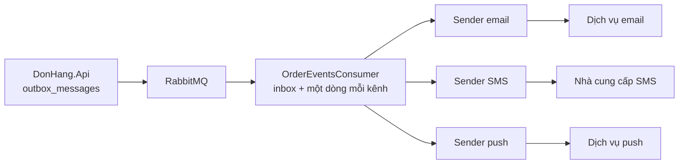

# Review thiết kế: thông báo nhiều kênh

Theo `design-review-template.md`. Gửi trước buổi review; câu hỏi trong buổi
review ghi ở mục cuối. Mọi con số ghi "giả định" là giả định của dự án; tài
liệu không nêu tên hay giá nhà cung cấp nào.

Trạng thái: đã review
Người đề xuất: lập trình viên backend

### Quyết định cần review

Mỗi kênh một sender trong Notifications; email gửi ít nhất một lần và là kênh
chính, SMS và push gửi nhiều nhất một lần; thử lại trong nhiều giờ theo nhịp
nhà cung cấp cho phép. Đề xuất ghi ở ADR 0027.

### Bối cảnh và driver (bước 1)

Yêu cầu ở `docs/team/notification-requirements.md`; không mở lại ADR 0002 và
0024. Driver xếp hạng:

1. Không mất email nào về đơn.
2. Email tới trong vài phút (giả định).
3. Ngày đông của một cửa hàng không làm chậm email của cửa hàng khác.
4. Một SMS đã trả tiền không gửi hai lần.

### Ước lượng và giả định (bước 2)

- Email: khoảng 6,6 mỗi giây ở giờ đông nhất, khoảng 1,2 mỗi giây trung bình
  ngày thường (2 email mỗi đơn, giả định).
- Trần một bản Notifications: 10 dòng mỗi 2 giây, 5 email mỗi giây. Giờ đông
  cần hai bản.
- Dịch vụ email cho phép 10 email mỗi giây (giả định, chờ hợp đồng).
- SMS: khoảng 0,7 mỗi giây ở giờ đông (20% số đơn chọn SMS, giả định).

### Sơ đồ tổng thể (bước 3)

Đường đi từ API tới consumer giữ nguyên như stage-3; chỉ phần sau khi message
tới Notifications đổi. Consumer lưu một dòng cho mỗi kênh khách chọn, cùng
transaction với dòng inbox; cột `Channel` của `Notification` (mọi dòng stage-3
là `email`) đã có chỗ cho việc này. Mỗi sender gọi nhà cung cấp qua một
interface của kênh, như `IEmailSender`.

### Đi sâu: thử lại (bước 4)

Stage-3: `NotificationSender` thử lại sau 2, 4, 8, 16 giây; lần lỗi thứ 5 là
cuối, dòng thành `failed` sau khoảng 30 giây. Đủ cho Mailpit trong lab; không
đủ khi dịch vụ email bên ngoài sập vài phút, vì mọi email trong lúc đó thành
`failed`.

Thiết kế mới, theo ADR 0027:

- Mỗi kênh thử lại trong 24 giờ (giả định), khoảng cách giữa hai lần tăng dần
  tới một trần, như `RefundSender` của Payments làm với cổng thanh toán.
- Mỗi sender gửi không quá tốc độ nhà cung cấp cho phép; với email, hai bản
  Notifications chia nhau 10 email mỗi giây.
- Hết 24 giờ, dòng thành `failed` và hiện cho đội vận hành để gửi lại bằng
  tay khi nhà cung cấp quay lại.

### Nút cổ chai và điểm hỏng đơn lẻ (bước 5)

- Nút cổ chai: tốc độ nhà cung cấp cho phép, không phải sender; thêm bản
  Notifications quá hai không gửi nhanh hơn được.
- Dịch vụ email là điểm hỏng đơn lẻ cho việc email tới, không cho việc đặt
  đơn: dòng chờ trong `donhang_notifications`.
- Theo định luật Little, dịch vụ email sập một giờ ở giờ đông để lại khoảng
  6,6 × 3.600 = khoảng 24.000 email. Hàng chờ chỉ giảm với tốc độ cho phép trừ
  email mới đến: 10 − 6,6 = 3,4 mỗi giây, khoảng 2 giờ. Ngày thường: khoảng
  4.300 email, giảm 8,8 mỗi giây, khoảng 8 phút.

### Phương án bị loại và điểm đánh đổi (bước 3 và 4)

- Một vòng gửi cho mọi kênh: một nhà cung cấp chậm làm chậm mọi kênh.
- API hay từng service gọi nhà cung cấp: trái ADR 0002.
- SMS ít nhất một lần: trái driver 4.
- Điểm đánh đổi: email ít nhất một lần (lợi: không mất email, driver 1; thiệt:
  có thể nhận hai lần). SMS và push nhiều nhất một lần (lợi: không trả tiền hai
  lần, driver 4; thiệt: có thể mất một tin).
- Điểm nhạy: email là kênh chính. Lựa chọn cho SMS chỉ an toàn khi mọi tin về
  đơn cũng đi bằng email; bỏ email khỏi một loại tin là mở lại ADR 0027.
- Điểm đánh đổi: theo nhịp nhà cung cấp, đổi độ trễ lấy việc không bị từ chối
  (driver 2 bị thiệt sau một lần sập, driver 1 được lợi).

### Rủi ro và câu hỏi mở

| Rủi ro hoặc câu hỏi | Ai trả lời (vai trò) | Hạn hoặc bước tiếp theo |
|---|---|---|
| Sender nhận dòng đến hạn theo `next_attempt_at`, không theo cửa hàng: ngày đông của một cửa hàng làm chậm email của cửa hàng khác (driver 3) | Lập trình viên backend | Bước tiếp: trần theo cửa hàng cho mỗi lượt nhận dòng, như ADR 0016 |
| Push cần bản app cho điện thoại, chưa có (ADR 0017) | Product owner | Push chờ bản đó; email và SMS không chờ |
| Tốc độ dịch vụ email cho phép là giả định | Product owner, hỏi nhà cung cấp | Trước khi nối Dịch vụ A |

### ADR sẽ viết

ADR 0027 (đã có). Chọn nhà cung cấp SMS và dịch vụ push: mỗi cái một ADR, theo
cách của ADR 0024.

### Câu hỏi phản biện trong buổi review

| Câu hỏi | Trả lời, trỏ driver, ADR hoặc rủi ro | Việc tiếp theo | Người phụ trách (vai trò) |
|---|---|---|---|
| Sao API không gọi thẳng nhà cung cấp SMS? | ADR 0002: mọi service báo tin cùng một cách; nhà cung cấp chậm nằm ngoài process nhận đơn | Không | |
| Dịch vụ email sập một ngày thì sao? | ADR 0027: thử lại 24 giờ, rồi `failed` cho đội vận hành gửi lại; sập lặp lại là xét điều kiện xem lại của ADR 0024 | Không | |
| Ngày khuyến mãi của một cửa hàng có làm chậm email cửa hàng khác không? | Có: sender nhận dòng theo thời gian, không theo cửa hàng | Ghi rủi ro; trần theo cửa hàng như ADR 0016 | Lập trình viên backend |
| Sao thiết kế push mà không xây? | Push cần bản app cho điện thoại (ADR 0017), chưa có | Ghi phụ thuộc | Product owner |
| Khách bỏ email, chỉ nhận SMS được không? | Không: email là kênh chính, điểm nhạy của ADR 0027 | Không | |
