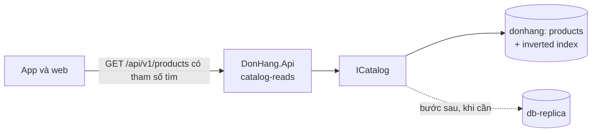

# Review thiết kế: tìm sản phẩm trong một cửa hàng

Theo `design-review-template.md`. Gửi trước buổi review; câu hỏi trong buổi
review ghi ở mục cuối. Mọi con số ghi "giả định" là giả định của dự án; tài
liệu không nêu tên công cụ tìm kiếm nào.

Trạng thái: đã review
Người đề xuất: lập trình viên backend, đội Cửa hàng (ADR 0025, giả định)

### Quyết định cần review

Tìm sản phẩm bằng full-text search của PostgreSQL, trong Catalog, như một tham
số tùy chọn của danh sách sản phẩm. Đề xuất ghi ở ADR 0030.

### Bối cảnh và driver (bước 1)

Yêu cầu ở `docs/team/product-search-requirements.md`; không mở lại ADR 0016,
0017, 0026. Driver xếp hạng:

1. Chữ gõ không dấu tìm ra sản phẩm.
2. Tìm kiếm không bao giờ lấy sức chứa mà đặt đơn cần.
3. Kết quả chỉ trong cửa hàng của người gọi.

### Ước lượng và giả định (bước 2)

- Nhiều nhất 5.000 sản phẩm mỗi cửa hàng, khoảng 200.000 dòng cả nền tảng (giả
  định): vừa trong PostgreSQL.
- Khoảng 27 lần tìm mỗi giây ở giờ đông (20% số lần đọc sản phẩm, giả định).

### Sơ đồ tổng thể (bước 3)

Đường đi: app gửi từ tìm trong tham số của danh sách sản phẩm; API đếm lần đọc
dưới `catalog-reads`; `ICatalog` chạy một truy vấn full-text search trên
`products`, lọc theo cửa hàng của người gọi, sắp theo mức khớp rồi `id`.
Replica là bước sau theo `capacity-plan.md`, không phải phần của thiết kế này.

### Đi sâu: gõ không dấu (bước 4)

- Tên lưu và câu tìm đi qua cùng một cách chuẩn hóa: chữ thường, bỏ dấu bằng
  `unaccent` đi kèm PostgreSQL, tách từ bằng một cấu hình không cắt đuôi từ
  (PostgreSQL không có cấu hình cho tiếng Việt).
- `Bàn phím cơ` trong `db/seed.sql` thành các từ `ban`, `phim`, `co`; câu
  `ban phim` thành `ban`, `phim`; hai từ khớp, sản phẩm được trả.
- Cùng cách đó, chữ gõ có dấu cũng khớp, vì cả hai bên đều đã bỏ dấu.
- Từ tìm được dựng trên chính dòng sản phẩm, nên đổi tên là đổi luôn từ tìm
  được; không bản sao nào phải đồng bộ.

### Nút cổ chai và điểm hỏng đơn lẻ (bước 5)

- Mỗi lần tìm là một truy vấn: `ProductCache` giữ sản phẩm theo `id`, không
  trả lời được câu tìm.
- Mỗi lần tìm chiếm một chỗ của `catalog-reads` (20 chạy, 5 chờ mỗi process);
  đó là giới hạn chạm trước, và nó trả `503` cho đọc sản phẩm, không cho đặt
  đơn.
- Điểm hỏng đơn lẻ: primary PostgreSQL, như danh sách sản phẩm hiện nay.

### Phương án bị loại và điểm đánh đổi (bước 3 và 4)

- `LIKE '%...%'`: đọc mọi dòng mỗi lần tìm, không bỏ dấu (trái driver 1, 2).
- Công cụ tìm kiếm riêng: một bản sao nuôi từ Catalog qua outbox, trễ, cần dựng
  lại, thêm một service; chưa cần ở cỡ đã ước lượng.
- Điểm đánh đổi, nơi chạy: trong PostgreSQL thì không gì mới phải chạy, không
  bản sao, nhưng câu tìm dùng chung database với đặt đơn.
- Điểm đánh đổi, khớp nguyên từ: không tìm ra từ gõ sai, không đồng nghĩa; chấp
  nhận tới điều kiện xem lại của ADR 0030.
- Điểm đánh đổi, không cache kết quả theo từ tìm: giả định phần lớn câu tìm
  khác nhau, nên cache ít trúng mà thêm một bản sao phải xóa khi đổi tên.

### Rủi ro và câu hỏi mở

| Rủi ro hoặc câu hỏi | Ai trả lời (vai trò) | Hạn hoặc bước tiếp theo |
|---|---|---|
| Tỉ lệ tìm trên đọc sản phẩm cao hơn giả định | Đội Cửa hàng | Đo sau khi có; lập lại `capacity-plan.md` nếu lệch |
| Khách gõ sai nhiều hơn dự tính | Product owner | Đếm phản hồi về tìm kiếm mỗi tháng |
| Tên có `đ` chuẩn hóa thế nào cần kiểm riêng | Tester | Thêm ca kiểm khi xây |

### ADR sẽ viết

ADR 0030 (đã có). Trang sản phẩm công khai cho máy tìm kiếm: quyết định riêng
theo ADR 0017, không ở đây.

### Câu hỏi phản biện trong buổi review

| Câu hỏi | Trả lời, trỏ driver, ADR hoặc rủi ro | Việc tiếp theo | Người phụ trách (vai trò) |
|---|---|---|---|
| Sao khách không tìm thấy sản phẩm của ta từ máy tìm kiếm? | ADR 0017: trang công khai là HTML từ server, quyết riêng; nếu làm, nó đọc cùng Catalog | Không | |
| Sao không dùng một công cụ tìm kiếm? | Ước lượng và driver; ADR 0030 ghi điều kiện mở lại, không loại hẳn | Không | |
| Cửa hàng lớn chuyển database theo ADR 0026 thì tìm kiếm ra sao? | Từ tìm được nằm trên dòng sản phẩm của cửa hàng, chuyển cùng dòng | Không | |
| Tìm kiếm có làm chậm đặt đơn lúc khuyến mãi? | `catalog-reads`, trần theo cửa hàng của ADR 0016, điều kiện chuyển sang replica trong `capacity-plan.md` | Không | |
| Có nên cache kết quả của các câu tìm phổ biến? | Mở: chưa có số đo câu tìm lặp lại | Đo sau khi có | Đội Cửa hàng |
