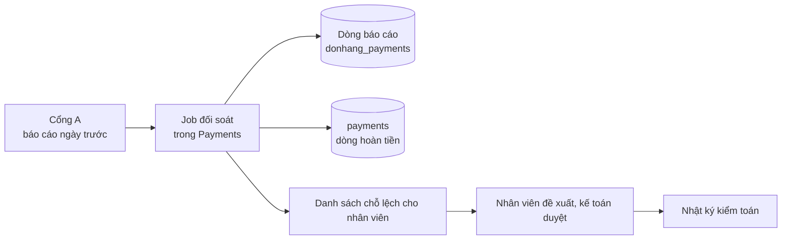

# Review thiết kế: đối soát hoàn tiền

Theo `design-review-template.md`. Gửi trước buổi review; câu hỏi trong buổi
review ghi ở mục cuối. Mọi con số ghi "giả định" là giả định của dự án.

Trạng thái: đã review
Người đề xuất: lập trình viên backend, cùng kế toán

### Quyết định cần review

Payments đối soát dòng hoàn tiền với báo cáo của cổng mỗi ngày một lần; job
không sửa gì, mọi chỗ lệch do người giải thích. Đề xuất ghi ở ADR 0028.

### Bối cảnh và driver (bước 1)

Yêu cầu ở `docs/team/reconciliation-requirements.md`; không mở lại ADR 0003,
0010. Driver xếp hạng:

1. Mọi chỗ lệch được giải thích.
2. Mỗi chỗ lệch được phát hiện trong một ngày.
3. Chỉ người sửa dòng tiền.

### Ước lượng và giả định (bước 2)

- Khoảng 1.000 khoản hoàn trong ngày đông nhất (1% số đơn, giả định): một lô
  nhỏ, tải không định hình thiết kế.
- Báo cáo của Cổng A ghi idempotency key mỗi khoản (giả định, lập trình viên
  làm tích hợp xác nhận).

### Sơ đồ tổng thể (bước 3)

Mỗi dòng báo cáo được ghép với dòng hoàn tiền theo key `refund-<id>`, vì
`payments` không giữ id hoàn tiền của cổng. Năm kết quả: khớp; cổng đã hoàn
nhưng dòng `failed`; khoản của cổng không có dòng; dòng `refunded` không có
trong báo cáo (chỉ thành chỗ lệch sau thêm một lần chạy); số tiền khác.

### Đi sâu: dòng `failed` mà cổng đã hoàn (bước 4)

1. `RefundSender` gọi cổng; cổng hoàn tiền, nhưng câu trả lời bị lạc (hết thời
   gian chờ). Kết quả là thử lại sau.
2. Cổng lỗi liên tục tới hết 24 giờ của YC-10; dòng thành `failed`,
   `payment.refund-failed` được gửi.
3. API nhận message đó: đơn quay về `paid`, khách nhận email báo hoàn tiền
   thất bại. Tiền thật ra đã hoàn.
4. Đối soát hôm sau thấy khoản của cổng với key `refund-<id>` của một dòng
   `failed`: một chỗ lệch.
5. Gửi muộn `payment.refunded` không sửa được: `Order.CompleteRefund()` chỉ nhận
   đơn `refunding`, ngoại lệ của nó thành poison message trong
   `PaymentEventsConsumer`, và message vào dead-letter queue.

Vì vậy cần một bước sửa mới cho đơn: đưa đơn `paid` sang `cancelled` khi
khoản hoàn đã được xác nhận qua đối soát. Đây là câu hỏi mở ở dưới.

### Nút cổ chai và điểm hỏng đơn lẻ (bước 5)

- Không nút cổ chai về tải: một lô khoảng 1.000 dòng mỗi ngày.
- API báo cáo của cổng là điểm hỏng đơn lẻ cho đối soát, không cho hoàn tiền:
  job chạy lại khi cổng quay lại; ngày bị lỡ được báo cho kế toán (giả định).

### Phương án bị loại và điểm đánh đổi (bước 3 và 4)

- Hỏi cổng sau mỗi khoản: thêm một lời gọi mỗi khoản, vẫn không thấy khoản
  hoàn làm ngoài Đơn Hàng; không thay được báo cáo.
- Chỉ tin câu trả lời của cổng: không có bản ghi thứ hai, trái driver 1.
- Điểm đánh đổi, tần suất: mỗi ngày một lần là một job và một báo cáo, nhưng
  một chỗ lệch nằm im tới một ngày (driver 2 vừa đủ).
- Điểm đánh đổi, cửa sổ 24 giờ của YC-10: dài hơn thì ít dòng `failed` mà cổng
  đã hoàn, nhưng đơn ở `refunding` lâu hơn và nhân viên chờ lâu hơn. Giữ 24 giờ.
- Điểm đánh đổi, sửa tay so với tự sửa: chậm hơn, nhưng không ai vừa làm vừa
  duyệt một thay đổi về tiền (driver 3).
- Điểm đánh đổi, lưu trữ: dòng báo cáo và kết quả giữ bằng thời gian giữ dòng
  hoàn tiền, làm bằng chứng cho kế toán, tốn chỗ lưu.

### Rủi ro và câu hỏi mở

| Rủi ro hoặc câu hỏi | Ai trả lời (vai trò) | Hạn hoặc bước tiếp theo |
|---|---|---|
| Đơn của dòng `failed` mà cổng đã hoàn kẹt ở `paid`: cần bước sửa mới cho đơn | Đội Đặt hàng (ADR 0025) | Mở; thiết kế bước sửa trước khi dựng đối soát |
| Dòng hoàn tiền không ghi cổng nào; cần cho bước 4 kế hoạch rời đi của ADR 0010 | Lập trình viên backend | Thêm cột cổng trước khi có cổng thứ hai |
| Báo cáo của Cổng A có thể không ghi idempotency key | Lập trình viên làm tích hợp cổng | Hỏi Cổng A; không có thì ghép theo đơn và số tiền, chỗ lệch nhiều hơn |

### ADR sẽ viết

ADR 0028 (đã có). Bước sửa cho đơn kẹt ở `paid`: một ADR nếu nó đổi các trạng
thái của đơn.

### Câu hỏi phản biện trong buổi review

| Câu hỏi | Trả lời, trỏ driver, ADR hoặc rủi ro | Việc tiếp theo | Người phụ trách (vai trò) |
|---|---|---|---|
| Mọi lời gọi đã có idempotency key, sao còn đối soát? | Key chặn hoàn lần hai (YC-9), không chặn câu trả lời bị lạc hay khoản hoàn làm tay | Không | |
| Sao không chỉ dùng báo cáo của cổng? | Chỉ hai bản ghi cùng nhau mới cho thấy khoản cổng đã hoàn cho một dòng `failed` | Không | |
| Báo cáo trễ hay cổng lỗi lúc chạy thì sao? | ADR 0028: chạy lại; ngày bị lỡ báo kế toán | Không | |
| Thêm cổng thứ hai theo ADR 0010 thì sao? | Rủi ro: dòng hoàn tiền không ghi cổng nào | Thêm cột cổng | Lập trình viên backend |
| Ai sửa đơn kẹt ở `paid`? | Mở | Thiết kế bước sửa | Đội Đặt hàng (ADR 0025) |
