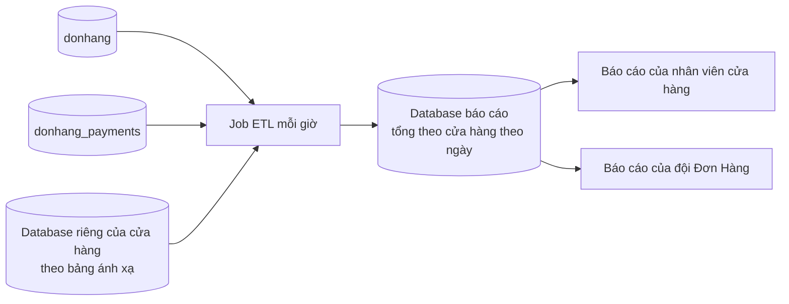

# Review thiết kế: báo cáo từ database báo cáo riêng

Theo `design-review-template.md`. Gửi trước buổi review; câu hỏi trong buổi
review ghi ở mục cuối. Mọi con số ghi "giả định" là giả định của dự án; tài
liệu không nêu tên công cụ nào.

Trạng thái: đã review
Người đề xuất: lập trình viên backend, đội Cửa hàng (ADR 0025, giả định)

### Quyết định cần review

Báo cáo đọc từ một database báo cáo riêng, nạp bằng job ETL mỗi giờ; job là
việc theo lịch, đọc từ các nguồn, đổi sang dạng người đọc cần, rồi nạp vào
chỗ riêng. Đề xuất ghi ở ADR 0031.

### Bối cảnh và driver (bước 1)

Yêu cầu ở `docs/team/reporting-requirements.md`; không mở lại ADR 0013, 0026,
0028. Driver xếp hạng:

1. Báo cáo không bao giờ lấy sức chứa mà đặt đơn cần.
2. Mỗi cửa hàng chỉ thấy số của mình.
3. Báo cáo gộp nhiều cửa hàng có cả cửa hàng ở database riêng.

### Ước lượng và giả định (bước 2)

- Khoảng 36 triệu đơn trong 2 năm giữ lại (giả định): báo cáo trên dữ liệu gốc
  đọc hàng chục triệu dòng.
- Tổng theo cửa hàng theo ngày: 1.000 cửa hàng × 730 ngày = khoảng 730.000 dòng
  cho mỗi loại số, nhỏ hơn dữ liệu gốc hàng chục lần.
- Mỗi lần chạy job chỉ đọc 3 ngày gần nhất (giả định): khoảng 150.000 đơn ngày
  thường, bằng các truy vấn ngắn.

### Sơ đồ tổng thể (bước 3)

Đường đi: job đọc bảng ánh xạ cửa hàng, đọc từng nguồn theo ngày gần đây, ghi
tổng theo cửa hàng theo ngày; báo cáo chỉ đọc database báo cáo. Nhân viên đọc
dòng có shop id của cửa hàng lấy từ access token; đội Đơn Hàng đọc mọi dòng.

### Đi sâu: cửa hàng chuyển database (bước 4)

- Job đọc bảng ánh xạ của ADR 0026 ở mỗi lần chạy, không giữ danh sách database
  cố định.
- Cửa hàng chuyển giữa hai lần chạy: lần sau đọc số của nó từ database mới; tổng
  của những ngày đã tính lại được thay bằng số từ chỗ mới.
- Trong khoảng dừng ghi lúc chuyển, không đơn mới nào của cửa hàng đó; số của
  nó không bị đếm hai lần, vì dòng cũ chỉ bị xóa sau khoảng kiểm tra và job đọc
  đúng một chỗ theo bảng ánh xạ.
- Đây là câu trả lời cho câu hỏi mở "báo cáo gộp mọi cửa hàng" của
  `multi-shop-design-review.md`: job đọc từng database rồi gộp, không cần một
  truy vấn join hai database.

### Nút cổ chai và điểm hỏng đơn lẻ (bước 5)

- Tải job đặt lên nguồn: truy vấn ngắn theo 3 ngày gần nhất, mỗi giờ một lần;
  nhỏ so với đặt đơn.
- Truy vấn báo cáo dài chỉ chạm database báo cáo, không lấy kết nối của
  primary.
- Database báo cáo hỏng: báo cáo dừng, đặt đơn không bị gì; dựng lại từ nguồn.
- Job hỏng: số cũ dần, mỗi báo cáo vẫn ghi thời điểm chốt số.

### Phương án bị loại và điểm đánh đổi (bước 3 và 4)

- Báo cáo trên primary: trái driver 1.
- Báo cáo trên `db-replica`: bản sao cả server `db`, vẫn không join hai
  database trong một truy vấn, không có cửa hàng ở database riêng (trái driver
  3).
- Read model nuôi từ message: `OrderMessage` không có số tiền hay dòng hàng, và
  đơn cũ không đọc lại được từ broker.
- Điểm đánh đổi, chu kỳ: mỗi giờ giữ tải thêm lên nguồn nhỏ, nhưng số cũ tới
  một giờ cộng thời gian job chạy.
- Điểm đánh đổi, lô so với message: lô không đổi `OrderMessage`, nhưng không
  bao giờ là số trực tiếp.
- Điểm đánh đổi, tổng theo ngày: trả lời nhanh các câu đã thỏa thuận; câu mới
  (doanh số theo giờ) cần bảng tổng mới.
- Điểm đánh đổi, dựng lại thay vì sao lưu: không thêm bản sao lưu, đổi lại thời
  gian dựng lại khi mất.

### Rủi ro và câu hỏi mở

| Rủi ro hoặc câu hỏi | Ai trả lời (vai trò) | Hạn hoặc bước tiếp theo |
|---|---|---|
| Thay đổi cũ hơn 3 ngày (ví dụ hoàn tiền muộn) không tới báo cáo | Lập trình viên backend | Chạy lại toàn bộ mỗi tuần (giả định) |
| Doanh thu báo cáo khác số kế toán | Kế toán | Payments là chủ; đối soát theo ADR 0028 giải thích chỗ lệch |
| Báo cáo cần sản phẩm bán chạy theo giờ | Product owner | Mở; bảng tổng mới nếu có yêu cầu |

### ADR sẽ viết

ADR 0031 (đã có). Yêu cầu số liệu trực tiếp: ADR mới, thay đổi message đơn.

### Câu hỏi phản biện trong buổi review

| Câu hỏi | Trả lời, trỏ driver, ADR hoặc rủi ro | Việc tiếp theo | Người phụ trách (vai trò) |
|---|---|---|---|
| Sao doanh thu báo cáo khác số kế toán? | `data-ownership.md`: database báo cáo giữ bản sao, Payments là chủ tiền; đối soát của ADR 0028 giải thích chỗ lệch | Không | |
| Sao không đọc thẳng `db-replica`? | Doanh thu join hai database; cửa hàng chuyển theo ADR 0026 nằm ở database riêng | Không | |
| Nhân viên cửa hàng A có thấy số cửa hàng B? | Mỗi dòng tổng mang shop id, đọc theo cửa hàng trong access token, như ADR 0013 | Không | |
| Cho một màn hình doanh số trực tiếp được không? | Yêu cầu mới, mở lại ADR 0031: message đơn phải mang số tiền | Ghi yêu cầu | Product owner |
| Job hỏng một ngày thì sao? | Số cũ dần, thời điểm chốt số cho người đọc thấy; chạy lại tính lại 3 ngày | Cảnh báo khi job trễ | Đội Cửa hàng |
