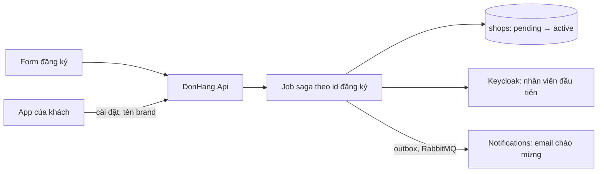

# Review thiết kế: cửa hàng tự đăng ký, gói và rời nền tảng

Theo `design-review-template.md`. Gửi trước buổi review; câu hỏi trong buổi
review ghi ở mục cuối. Mọi con số ghi "giả định" là giả định của dự án; tài
liệu không nêu giá nào.

Trạng thái: đã review
Người đề xuất: lập trình viên backend, đội Cửa hàng (ADR 0025, giả định)

### Quyết định cần review

Cửa hàng tự đăng ký bằng một saga nhiều bước chạy trong job nền; gói và cài đặt
là dữ liệu của cửa hàng; brand chọn trong các brand dựng sẵn. Đề xuất ghi ở ADR
0033; chi phí mỗi cửa hàng ở `cost-per-shop.md`.

### Bối cảnh và driver (bước 1)

Yêu cầu ở `docs/team/saas-platform-requirements.md`; không mở lại ADR 0012,
0013, 0016, 0022, 0026. Driver xếp hạng:

1. Cửa hàng mở mà không ai ở Đơn Hàng phải làm gì.
2. Không cài đặt của cửa hàng nào lọt sang cửa hàng khác.
3. Biết chi phí mỗi cửa hàng của từng gói.
4. Dữ liệu của cửa hàng rời đi hết vào một ngày đã nói.

### Ước lượng và giả định (bước 2)

- Khoảng 5 đăng ký mỗi ngày (giả định): bài toán đúng sai, không phải tải.
- Một cửa hàng rời đi trung bình có vài nghìn đơn (giả định): xóa theo lô vài
  trăm dòng mỗi lần là đủ ngắn để không giữ khóa lâu.

### Sơ đồ tổng thể (bước 3)

Đường đi: form gửi đăng ký → API ghi một dòng đăng ký → job chạy từng bước theo
id đăng ký. App của khách đọc tên cửa hàng, cài đặt và tên brand của cửa hàng
qua API, rồi dùng brand dựng sẵn có cùng tên trong app.

### Đi sâu: đăng ký (bước 4)

1. Tạo dòng `shops` ở `pending`, với gói đã chọn.
2. Tạo tài khoản nhân viên đầu tiên trong Keycloak, role `staff`, mang cửa hàng
   (token mang cửa hàng từ release 2).
3. Ghi message chào mừng vào outbox; Notifications gửi email ít nhất một lần.
4. Đặt cửa hàng `active`.

Hai chủ (database của Đơn Hàng và Keycloak) nên không transaction nào bao cả
bốn bước. Mỗi bước kiểm đã làm chưa trước khi làm (dòng `shops` theo id đăng
ký đã có; tài khoản đã có), nên job chạy lại từ đầu an toàn. Một bước lỗi mãi:
cửa hàng ở `pending`, hiện cho nhân viên Đơn Hàng theo vai trò; không bao giờ
mở một nửa.

### Đi sâu: rời đi (bước 4)

Đi theo mọi chỗ có dữ liệu của cửa hàng trong `data-ownership.md`:

1. Cửa hàng chuyển `leaving`; job xuất dữ liệu của cửa hàng và gửi cho cửa hàng.
2. Hết 30 ngày chờ (giả định): xóa theo lô trong `donhang`, `donhang_payments`,
   `donhang_notifications` và `donhang_support`; hoặc bỏ database riêng nếu
   cửa hàng đã chuyển theo ADR 0026.
3. Dòng tổng trong database báo cáo được dựng lại không còn cửa hàng đó (ADR
   0031).
4. Bản sao trong Redis hết theo TTL; bản trong backup hết khi backup hết hạn
   giữ. Ngày cuối cùng dữ liệu còn tồn tại = ngày xóa + thời hạn giữ backup.

### Nút cổ chai và điểm hỏng đơn lẻ (bước 5)

- Không nút cổ chai về tải. Xóa theo lô, không một lệnh xóa lớn, để không giữ
  khóa lâu trên bảng chung đang phục vụ cửa hàng khác.
- Keycloak hỏng: đăng ký dừng ở bước 2, cửa hàng chờ ở `pending`; cửa hàng đang
  chạy không bị gì.

### Phương án bị loại và điểm đánh đổi (bước 3 và 4)

- Mở tay bởi nhân viên Đơn Hàng: trái driver 1.
- Một transaction gộp: Keycloak là chủ khác, không làm được.
- Điểm đánh đổi, brand dựng sẵn so với màu tự do: mọi brand qua test tương
  phản, đổi lại cửa hàng ít lựa chọn và thêm brand cần phát hành app.
- Điểm đánh đổi, gói là trần so với giữ chỗ: phần không dùng vẫn để cửa hàng
  khác dùng; gói cao hơn không được bảo đảm chỗ.
- Điểm đánh đổi, chi tiết đo so với chi phí telemetry: ở `cost-per-shop.md`.

### Rủi ro và câu hỏi mở

| Rủi ro hoặc câu hỏi | Ai trả lời (vai trò) | Hạn hoặc bước tiếp theo |
|---|---|---|
| Đăng ký giả hàng loạt | Đội Cửa hàng | Giới hạn đăng ký mỗi địa chỉ email, xác minh email trước bước 2 |
| Thời hạn giữ backup làm ngày xóa cuối cùng xa hơn cửa hàng nghĩ | Product owner, cùng bộ phận pháp chế | Ghi rõ trong điều khoản |
| Cửa hàng rời đi có dòng hoàn tiền đang `pending` | Đội Đặt hàng | Mở; chờ hoàn tiền xong rồi mới xóa |

### ADR sẽ viết

ADR 0033 (đã có). Màu tự do hay logo: ADR mới theo điều kiện xem lại của 0033.

### Câu hỏi phản biện trong buổi review

| Câu hỏi | Trả lời, trỏ driver, ADR hoặc rủi ro | Việc tiếp theo | Người phụ trách (vai trò) |
|---|---|---|---|
| Cho một khách lớn bản nền tảng riêng được không? | Điều kiện xem lại của ADR 0012: hợp đồng đòi thì có, các cửa hàng khác vẫn phục vụ như cũ | Không | |
| Cửa hàng gói rẻ có làm chậm cửa hàng gói cao? | ADR 0016: trần giới hạn phần của mỗi cửa hàng; gói chỉ đổi cỡ trần, không giữ chỗ | Không | |
| Chứng minh dữ liệu của cửa hàng đã đi rồi thế nào? | Đi theo `data-ownership.md`: xóa trong từng database, dựng lại dòng báo cáo (ADR 0031), cache hết TTL, backup hết hạn | Ghi biên bản xóa | Đội Cửa hàng |
| Sao cửa hàng gói cao nhất không có cluster riêng? | ADR 0022 và phần nền cố định mỗi cluster của `cluster-cost.md`: gói đó phải gánh một mình | Không | |
| Cửa hàng có database riêng (ADR 0026) rời đi thì sao? | Bỏ database đó sau thời gian chờ | Không | |
