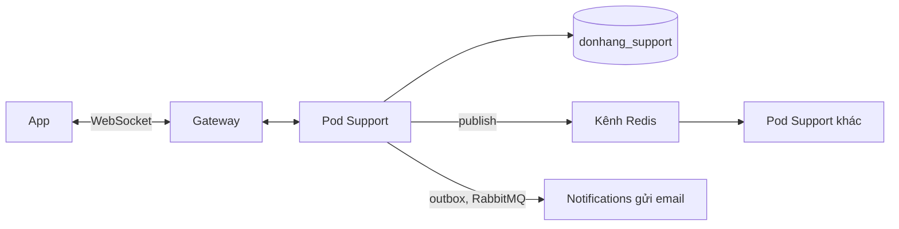

# Review thiết kế: chat hỗ trợ

Theo `design-review-template.md`. Gửi trước buổi review; câu hỏi trong buổi
review ghi ở mục cuối. Mọi con số ghi "giả định" là giả định của dự án.

Trạng thái: đã review
Người đề xuất: lập trình viên backend, đội Đặt hàng (ADR 0025, giả định)

### Quyết định cần review

Chat hỗ trợ qua WebSocket trong service riêng `DonHang.Support`; tin lưu
PostgreSQL trước, chuyển giữa Pod qua publish/subscribe của Redis. Đề xuất ghi
ở ADR 0032.

### Bối cảnh và driver (bước 1)

Yêu cầu ở `docs/team/support-chat-requirements.md`; không mở lại ADR 0013,
0016, 0017, 0019. Driver xếp hạng:

1. Tin tới màn hình đang mở trong vài giây.
2. Không mất tin khi việc chuyển tin hỏng.
3. Nhân viên không bao giờ thấy chat của cửa hàng khác.
4. Chat không bao giờ lấy sức chứa mà đặt đơn cần.

### Ước lượng và giả định (bước 2)

- Khoảng 100 cuộc mở cùng lúc ở giờ đông, khoảng 200 kết nối (Little's law,
  giả định trong tài liệu yêu cầu).
- Khoảng 1,7 tin mỗi giây: mỗi tin một lần ghi ngắn vào `donhang_support`.
- Kết nối mỗi Pod với 2 Pod: khoảng 100 (giả định chia đều).

### Sơ đồ tổng thể (bước 3)

Đường đi của một tin: app gửi qua kết nối đang mở → Pod lưu vào
`donhang_support` (kèm cửa hàng từ access token) → Pod publish lên kênh Redis →
mọi Pod chuyển tin cho kết nối của cuộc trò chuyện đó. Tin chưa đọc sau 5 phút
→ outbox → RabbitMQ → Notifications gửi email (ADR 0027).

### Đi sâu: kết nối rớt (bước 4)

- Kết nối rớt (mạng điện thoại, Pod bị thay khi phát hành): app nối lại sau một
  khoảng chờ có jitter, để các app không cùng nối lại một lúc.
- Khi nối lại, app gửi id của tin cuối nó có; Pod đọc các tin sau id đó từ
  database và gửi trước, rồi mới gửi tin mới.
- Tin tới trong lúc rớt chỉ bị lỡ ở phần chuyển qua Redis; database vẫn có, nên
  không mất tin (driver 2).
- Không mở lại được kết nối: app hỏi lại mỗi vài giây, đường lui của ADR 0032.

### Nút cổ chai và điểm hỏng đơn lẻ (bước 5)

- Tài nguyên khan hiếm là số kết nối giữ mở mỗi Pod, phần lớn thời gian không
  có tin; kế hoạch dung lượng của Support đếm kết nối ở giờ đông, không đếm
  request mỗi giây.
- Kết nối chat không giữ kết nối database: Pod chỉ mở một kết nối khi lưu hay
  đọc tin. `max_connections` giới hạn tốc độ ghi tin, không giới hạn số khách
  đang nối.
- Redis (1 bản): sập thì chỉ mất chuyển tiếp giữa Pod; tin vẫn lưu, app đọc lại
  khi nối lại.
- Server `db`: sập thì không lưu được tin, chat dừng; đặt đơn cũng dừng, như hôm
  nay.

### Phương án bị loại và điểm đánh đổi (bước 3 và 4)

- Hỏi lại mỗi vài giây: tải theo số màn hình × tần suất, tin chờ tới một chu
  kỳ; giữ làm đường lui.
- Module trong `DonHang.Api`: dùng chung Pod, giới hạn, canary với việc nhận
  đơn (trái driver 4).
- SignalR: hoãn, vì ASP.NET Core không có client SignalR cho Dart.
- Điểm đánh đổi, kết nối giữ mở so với hỏi lại: tin tới ngay (driver 1), đổi lại
  một tài nguyên mới phải đếm và mỗi lần phát hành đóng kết nối.
- Điểm đánh đổi, Redis nhiều nhất một lần: chuyển tin rẻ, chấp nhận vì
  PostgreSQL là bản ghi (driver 2).
- Điểm đánh đổi, WebSocket tự viết so với SignalR: tự viết nối lại và chuyển
  giữa Pod, đổi lại không cần client Dart chưa có.

### Rủi ro và câu hỏi mở

| Rủi ro hoặc câu hỏi | Ai trả lời (vai trò) | Hạn hoặc bước tiếp theo |
|---|---|---|
| Ngày khuyến mãi của một cửa hàng giữ nhiều kết nối, chiếm chỗ của cửa hàng khác | Đội Đặt hàng | Trần kết nối theo cửa hàng kiểu ADR 0016, đặt sau khi đo |
| Gateway có đóng kết nối dài không trả lời trong một khoảng không | Đội platform | Kiểm cấu hình Gateway trước khi xây |
| Kết nối mang access token thế nào khi mở WebSocket | Đội Đặt hàng | Quyết khi xây; token hết hạn thì nối lại với token mới |

### ADR sẽ viết

ADR 0032 (đã có). Push cho bản điện thoại: ADR mới khi có bản đó.

### Câu hỏi phản biện trong buổi review

| Câu hỏi | Trả lời, trỏ driver, ADR hoặc rủi ro | Việc tiếp theo | Người phụ trách (vai trò) |
|---|---|---|---|
| Sao khách không nhận thông báo trên điện thoại? | ADR 0017: chưa có bản điện thoại; tin chưa đọc đi bằng email theo ADR 0027 | Không | |
| Nhân viên cửa hàng A đọc được chat cửa hàng B? | Không: mỗi dòng mang cửa hàng từ access token, row-level security như ADR 0013 | Không | |
| Ngày khuyến mãi một cửa hàng làm gì chat của cửa hàng khác? | Rủi ro: trần kết nối theo cửa hàng kiểu ADR 0016, đặt sau khi đo | Đo kết nối theo cửa hàng | Đội Đặt hàng |
| Sao chat không là một module của `DonHang.Api`? | ADR 0032, driver 4: kết nối giữ lâu dùng chung Pod, giới hạn và canary với nhận đơn | Không | |
| Phát hành Support thì chat đang mở ra sao? | ADR 0019 và 0032: rolling update đóng kết nối của Pod bị thay, app nối lại có jitter | Không | |
