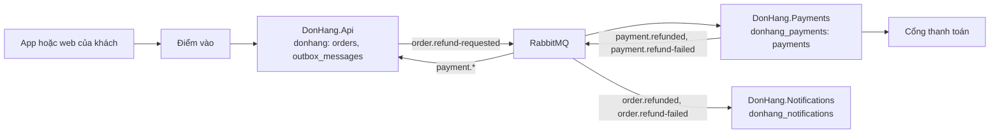

# Cách làm system design trong Đơn Hàng

Trạng thái: cách làm của đội từ stage-4. Mỗi bài toán thiết kế mới đi qua năm
bước dưới đây, rồi được review bằng `design-review-template.md`. Ví dụ đi kèm
là luồng hoàn tiền đã làm ở stage-3, nhìn lại theo các bước; ví dụ không quyết
lại điều gì của `refund-design.md` hay ADR 0003. Mọi con số ghi "giả định" là
giả định của dự án, không phải số đo.

### Các bước

1. Làm rõ yêu cầu. Đầu ra: phạm vi, các thao tác chính, kịch bản thuộc tính
   chất lượng, ràng buộc, giả định kèm người xác nhận, danh sách driver xếp
   hạng.
2. Ước lượng nhanh. Đầu ra: cỡ của tải và của dữ liệu, mỗi số kèm giả định và
   quyết định nó phục vụ.
3. Thiết kế tổng thể. Đầu ra: một sơ đồ các phần chính và đường đi của từng
   thao tác chính qua sơ đồ.
4. Đi sâu một đến ba phần. Đầu ra: thiết kế chi tiết của phần khó nhất, kèm
   phương án bị loại.
5. Tìm nút cổ chai và điểm hỏng đơn lẻ. Đầu ra: phần giới hạn trước, phần kế
   tiếp, và với mỗi điểm hỏng đơn lẻ thì thao tác nào dừng, chờ hay chạy ở mức
   giảm.

Sau năm bước, đầu ra được gom vào một tài liệu theo `design-review-template.md`
và gửi cho người review. Các bước là một vòng lặp, không phải một đường thẳng:
phần đi sâu làm hỏng một driver thì quay về sơ đồ tổng thể; một câu hỏi chưa
có trả lời thì quay về bước làm rõ yêu cầu.

### Câu hỏi làm rõ

Danh sách tính năng ít khi đổi hình dạng của thiết kế. Các câu hỏi dưới đây
thường đổi được, nên bước 1 hỏi theo từng nhóm:

- Ai dùng, và thao tác chính của họ là gì.
- Bao nhiêu: người dùng, thao tác mỗi giây, dữ liệu, giờ đông nhất.
- Dữ liệu nào được phép cũ, hay được phép đến trễ, và bao lâu.
- Điều gì không bao giờ được xảy ra.
- Khi một phần phụ thuộc hỏng thì thao tác nào phải vẫn chạy.
- Ràng buộc không phải tính năng: đội làm, thời hạn, quyết định đã có trong
  ADR, yêu cầu tuân thủ.

Câu chưa ai trả lời được không chặn thiết kế: nó thành một giả định ghi rõ, kèm
người xác nhận theo vai trò. Thiết kế đi tiếp với giả định đó và được kiểm lại
khi có câu trả lời.

### Ví dụ hoàn tiền: driver

Đây là nhìn lại luồng hoàn tiền đã làm ở stage-3 (`refund-requirements.md`,
`refund-design.md`, ADR 0003), không quyết lại gì. Driver xếp hạng:

1. YC-7: yêu cầu hoàn tiền được nhận và trả lời trong 2 giây, kể cả khi cổng
   thanh toán lỗi.
2. YC-9: một đơn không bao giờ được hoàn tiền hai lần, kể cả khi phải gửi lại.
3. Khóa API của cổng và các dòng tiền là phần nhạy cảm nhất của hệ thống, như
   bối cảnh của ADR 0003.

YC-1 đến YC-6 thêm tính năng (ai được yêu cầu, số tiền, trạng thái, email,
danh sách cho nhân viên) mà không đổi hình dạng của thiết kế. YC-10 (thử lại
trong 24 giờ) đi theo YC-7 và YC-9.

### Ước lượng nhanh

- Số làm tròn: hàng chục, hàng nghìn hay hàng triệu, không phải số chính xác.
- Mọi giả định ghi chữ "giả định", ngay tại chỗ dùng.
- Giữ đơn vị ở từng bước (đơn mỗi ngày, rồi đơn mỗi giây), để thấy phép tính
  sai khi đơn vị không khớp.
- Ghi quyết định mà con số phục vụ, và dừng khi con số đã đủ để giữ hay loại
  một phương án.
- Ước lượng đến trước khi có gì để đo. Khi đã đo được (như
  `scripts/backend/load-steps.sh` đo trần đọc trong `capacity-plan.md`), số
  đo thay cho số ước lượng.

### Ví dụ hoàn tiền: ước lượng

Quyết định cần con số: tải có định hình luồng hoàn tiền không.

- Số đơn lấy từ giả định của `capacity-plan.md`, không đặt số mới: 100.000 đơn
  trong ngày đông nhất, 12.000 đơn trong giờ đông nhất của ngày đó (khoảng 3,3
  đơn mỗi giây).
- Tỉ lệ đơn bị yêu cầu hoàn tiền: 1% (giả định).
- Yêu cầu hoàn tiền: khoảng 1.000 mỗi ngày đông nhất, khoảng 120 trong giờ đông
  nhất, tức khoảng 0,03 yêu cầu mỗi giây. Một phần trăm của lượng đơn: một phần
  nhỏ.

Kết luận: tải không định hình luồng hoàn tiền; cổng thanh toán lỗi mới định
hình nó. Vì vậy thiết kế dồn công vào thử lại và idempotency key, không vào
việc mở rộng.

Theo định luật Little, số dòng đang chờ = tốc độ đến × thời gian chờ. Cổng lỗi
24 giờ (YC-10) thì số dòng `pending` khoảng 1.000 yêu cầu mỗi ngày × 1 ngày =
khoảng 1.000 dòng; kể cả khi cả 24 giờ đều đông như giờ đông nhất, 120 mỗi giờ
× 24 giờ là khoảng 3.000 dòng. Một bảng PostgreSQL chứa thoải mái.

### Ví dụ hoàn tiền: sơ đồ tổng thể

Mỗi kho có một chủ theo `data-ownership.md`; không service nào ghi vào
database của service khác. Đường đi của từng thao tác chính:

- Gửi yêu cầu: khách → điểm vào → API đổi đơn sang `refunding` và ghi outbox
  trong một transaction → `202`. Cổng lỗi không chạm tới đường này.
- Gửi sang cổng: relay đưa outbox lên RabbitMQ → Payments ghi dòng `pending`
  → job nền gọi cổng. Cổng lỗi: dòng chờ và được thử lại.
- Nhận kết quả: Payments ghi kết quả và message vào outbox của nó → RabbitMQ →
  API đổi đơn → Notifications gửi email.
- Nhân viên xem yêu cầu `failed`: điểm vào → `GET /api/v1/refunds?status=failed`
  của Payments.

### Ví dụ hoàn tiền: đi sâu

Mỗi phần đi sâu trả lời cùng các câu hỏi: phần đó sở hữu dữ liệu nào; mỗi thao
tác cần nhất quán tới đâu; làm gì khi từng phụ thuộc hỏng; lớn lên theo tải ra
sao.

Ví dụ đi sâu phần gửi sang cổng, vì YC-9 và YC-10 khó nhất ở đó: gửi lại nhiều
lần mà không hoàn hai lần, chờ cổng tới 24 giờ. Không đi sâu danh sách `failed`
của nhân viên: không driver nào làm khó nó, nó chỉ là một truy vấn đọc.

Phần đi sâu đó chính là `refund-design.md`; file này không chép lại. Tóm lại:
mỗi bước là một transaction cục bộ nối bằng outbox và inbox, mỗi lần gửi lại
dùng cùng key `refund-<id>`, cổng được thử lại trong 24 giờ trước khi dòng
thành `failed`, và hai phương án bị loại (two-phase commit, gọi cổng ngay
trong request) có lý do ghi ở đó.

### Ví dụ hoàn tiền: nút cổ chai và điểm hỏng đơn lẻ

Nút cổ chai về tải: không tính lại ở đây. `capacity-plan.md` đã đi tải đỉnh qua
các phần dùng chung và ghi phần cạn trước ở mục "Tài nguyên hết trước"
(`catalog-reads`, không phải đặt đơn hay hoàn tiền). Với khoảng 0,03 yêu cầu
mỗi giây, hoàn tiền không chạm giới hạn nào trong đó.

Điểm hỏng đơn lẻ của luồng, theo repo stage-4 (`api` có 2 Pod; các phần còn
lại một bản):

| Phần hỏng | Gửi yêu cầu | Hoàn tiền xong |
|---|---|---|
| Cổng thanh toán | Chạy: outbox nhận, `202` | Chờ: thử lại 24 giờ, rồi `failed` cho nhân viên |
| Server PostgreSQL `db` (ba database) | Dừng: không ghi được đơn | Dừng |
| RabbitMQ | Chạy: dòng nằm trong outbox | Chờ tới khi RabbitMQ quay lại |
| `DonHang.Payments` (1 bản) | Chạy | Chờ: message nằm trong hàng đợi |
| `DonHang.Notifications` (1 bản) | Chạy | Đơn vẫn `cancelled`; chỉ email chờ |
| Keycloak (1 bản) | Dừng với khách cần đăng nhập lại | Chạy |
| Một Pod `api` | Chạy ở mức giảm trên Pod còn lại | Chạy |

Cổng thanh toán là điểm hỏng đơn lẻ cho việc hoàn tiền xong, nhưng không cho
việc nhận yêu cầu: outbox và 24 giờ thử lại để yêu cầu chờ.

### Ví dụ hoàn tiền: câu hỏi phản biện

- Vì sao không gọi cổng ngay trong request của khách? YC-7: cổng lỗi hay chậm
  thì khách chờ rồi nhận lỗi, và yêu cầu không được ghi lại.
- Vì sao không dùng two-phase commit? ADR 0003 và `refund-design.md`: RabbitMQ
  và API HTTP của cổng không tham gia được transaction như thế.
- Cổng lỗi hai ngày thì sao? YC-10: thử lại 24 giờ, rồi dòng thành `failed`,
  đơn quay về `paid` và hiện cho nhân viên (YC-6).
- Gửi lại có hoàn hai lần không? Không, theo YC-9: mọi lần gửi lại dùng cùng key
  `refund-<id>`.
- Cổng không nhận idempotency key thì sao? Rủi ro R2 trong `refund-design.md`:
  bước gửi phải hỏi trạng thái hoàn tiền trước mỗi lần gửi lại.
- Cổng cho hoàn tiền tối đa bao nhiêu ngày sau thanh toán? Chưa biết. Đây là
  câu hỏi mở trong `refund-requirements.md`; bên cung cấp cổng trả lời, product
  owner hỏi.

Quy tắc: câu phản biện cho thấy một driver đã đổi thì quyết định được mở lại
bằng một ADR mới, không bảo vệ quyết định cũ trong buổi review.
